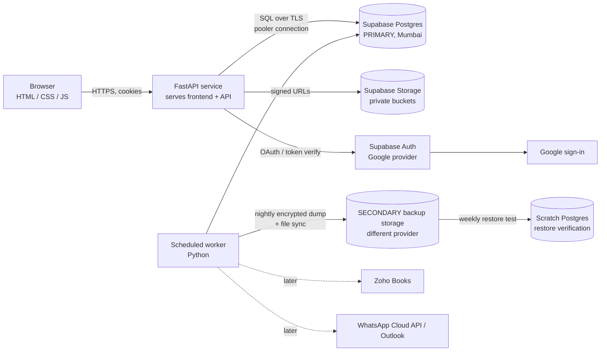
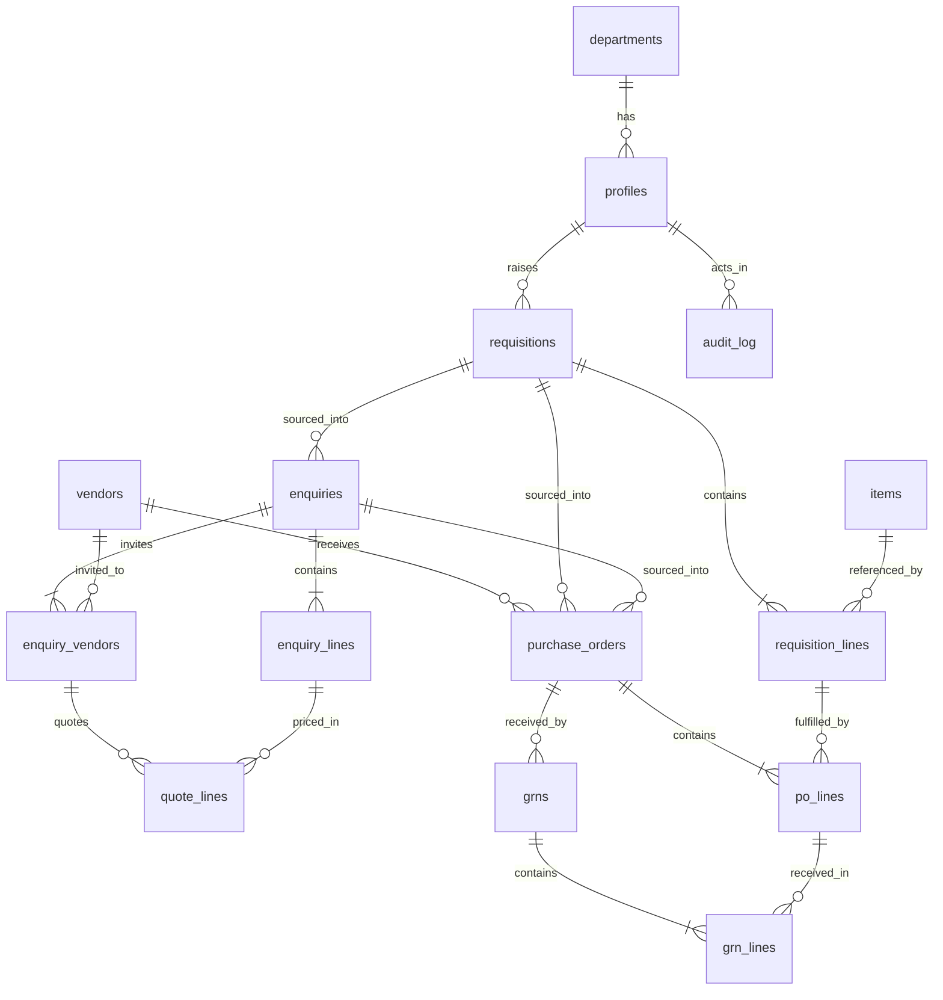

# IBC ProcureFlow — Implementation Plan

**Client:** Industrial Bolt Centre (IBC)
**Document type:** Design and implementation plan (no code in this document)
**Status:** Plan approved in principle; this version adds Google OAuth login, a two-role model (Manager / Employee), and the primary + secondary database design.
**Stack:** Python (FastAPI) backend · HTML / CSS / vanilla JavaScript frontend · Supabase (PostgreSQL, Auth, Storage)

> The previous ChatGPT-generated codebase was used **only as a source of business logic**. No code is reused. Every item in this plan is designed fresh.

---

## Table of contents

1. Goals, scope and non-goals
2. Users, roles and the two interfaces
3. Login and access management (Google OAuth)
4. System architecture
5. Business workflows and state machines
6. Database design (primary)
7. Backup and disaster recovery (secondary database)
8. API design
9. Backend structure
10. Frontend and UI design
11. Security design
12. Documents, PDFs and file storage
13. Notifications and integrations
14. Testing, CI/CD, deployment and monitoring
15. Delivery phases and acceptance criteria
16. Risks
17. Decisions needed from the client
18. Appendix: configuration reference

---

## 1. Goals, scope and non-goals

### Goals
- A secure, browser-based procurement system for IBC covering: **Purchase Requisition (PR) → Manager approval → Enquiry / Purchase Order (PO) → PO approval → Goods Receipt Note (GRN) → PO closure**.
- Sign-in with **Google**. Only people IBC has authorised can enter.
- Two clear interfaces: **Manager** and **Employee**.
- A database that is safe: transactional, audited, backed up in more than one place, and restorable (tested).
- Item and vendor master data kept in step with **Zoho Books** (one-way, Zoho → ProcureFlow) in a later phase.
- Reports: vendor-wise history and item-wise price history.

### In scope (v1)
Login and access management, departments, items, vendors, PR, approvals, enquiries (with quotes), PO, PO approval, GRN, PO PDF, file attachments, reports, custom fields, audit log, notifications (in-app), backups.

### Later phases
Zoho Books sync, WhatsApp Cloud API, Outlook email sending.

### Non-goals
- No stock-on-hand or inventory balance tracking (GRNs close procurement transactions only).
- No accounting, invoicing or payments (Zoho Books remains the accounting system).
- No Google Drive or other Google Cloud services. Google is used **only as the sign-in provider**.

---

## 2. Users, roles and the two interfaces

There are exactly **two roles**. Each role gets its own interface.

| | **Manager** | **Employee** |
|---|---|---|
| Purpose | Approves, procures, administers | Raises requests, tracks them |
| Interface | Manager console | Employee workspace |
| Count | A few (at least 2 recommended, see §5.5) | Everyone else |

### 2.1 Permission matrix

| Capability | Employee | Manager |
|---|:--:|:--:|
| Sign in with Google | ✔ | ✔ |
| Create / edit own draft PR, submit, cancel own PR | ✔ | ✔ |
| View own PRs and their status | ✔ | ✔ |
| View **all** PRs | ✘ | ✔ |
| Search item catalogue (name, SKU, part number; **no rates shown**) | ✔ | ✔ |
| View vendors, rates, price history | ✘ | ✔ |
| Approve / reject PR (not own) | ✘ | ✔ |
| Create enquiry, record quotes, award vendor | ✘ | ✔ |
| Create PO, submit for approval | ✘ | ✔ |
| Approve PO (not the creator) | ✘ | ✔ |
| Record GRN, close / short-close PO | ✘ | ✔ |
| Manage items, vendors, custom fields, departments | ✘ | ✔ |
| **Invite users, assign role and department, deactivate** | ✘ | ✔ |
| View audit log and backup status | ✘ | ✔ |
| Reports and CSV export | ✘ | ✔ |

### 2.2 Optional capability flags (recommended)
Many companies have a purchase executive or store person who is not a manager. To keep exactly two interfaces but still support this, a manager can switch on **per-user capability flags** on an employee:

- `can_procure`: employee sees extra menu items for Enquiries, POs (create and submit only, **never approve**) and Vendors.
- `can_receive`: employee sees GRN entry only.

Both are **off by default**. They never grant approval rights. If the client does not want this, the flags simply stay off and nothing else changes.

### 2.3 Manager interface: screens

| Screen | What it does |
|---|---|
| Dashboard | Pending approvals (PRs and POs), POs awaiting delivery, overdue deliveries, open PRs, spend this month, recent activity |
| Approvals inbox | One queue for PRs and POs waiting on this manager, with approve / reject and mandatory note on reject |
| Requisitions | All PRs, filters (status, department, date, requester), detail with timeline |
| Enquiries | Create from PR, invite vendors, record quotes, side-by-side comparison, award |
| Purchase Orders | Create from PR / enquiry, line rates, GST, terms, submit, approve, send, PDF, amend, cancel |
| GRNs | Record receipt against a PO (received / accepted / rejected quantities), LR and invoice details, attachments |
| Items | Master list, search, add / edit / deactivate, CSV import |
| Vendors | Master list, search, add / edit / deactivate, CSV import |
| Reports | Vendor history, item price history, PR-to-PO turnaround, pending deliveries; CSV export |
| Team and access | Invite by email, set role and department, capability flags, deactivate / reactivate |
| Settings | Departments, custom fields, numbering, GRN tolerance, letterhead, approval rules |
| Audit log | Searchable, read-only history of every change |
| System status | Last backup time and result, last Zoho sync (later) |

### 2.4 Employee interface: screens

| Screen | What it does |
|---|---|
| My dashboard | My open PRs, those needing my action (rejected, returned), recent notifications |
| New requisition | Form with item typeahead, quantity, required-by date, purpose, attachments, custom fields |
| My requisitions | List with status, open detail with timeline, edit draft, cancel, re-submit after rejection |
| Item catalogue | Read-only search to find item names and part numbers |
| Notifications | In-app list (approved, rejected, PO raised, goods received) |
| Profile | Name, department, sign out |

---

## 3. Login and access management (Google OAuth)

### 3.1 Principle
**Authentication** (who are you?) is handled by Google through Supabase Auth.
**Authorisation** (what may you do?) is decided by IBC's own `profiles` table, which only managers can change.
A valid Google account is **not enough**: the email must already be authorised in ProcureFlow.

### 3.2 Login page
- Single clean page: IBC logo, product name, **"Sign in with Google"** button.
- Optional second option, **email + password**, controlled by a setting. Recommended default: **off**, except for one break-glass manager account so IBC is never locked out if Google has a problem.
- Clear messages for: access not granted, account deactivated, session expired.

### 3.3 Sign-in flow

1. User clicks "Sign in with Google". The browser goes to a backend endpoint.
2. The backend starts an OAuth **PKCE** flow with Supabase Auth (Google provider) and redirects to Google.
3. User chooses their Google account. Google returns to Supabase, which redirects to our backend callback with a one-time code.
4. The backend exchanges the code for a Supabase session and **verifies the token** (signature, expiry, issuer).
5. The backend reads the **verified** email and looks it up in `profiles`:
   - **Found, status `invited`**: first login. Link the Google identity to the profile, set status `active`, record first login.
   - **Found, status `active`**: continue.
   - **Found, status `deactivated`**: reject with "Account deactivated".
   - **Not found**: reject with "Access not granted. Ask an IBC manager to add your email." (Optionally create an access request for a manager to review, see §17.)
6. On success the backend sets the session in **HttpOnly, Secure, SameSite=Strict cookies** and redirects to `/app/manager` or `/app/employee` according to role.
7. Every later request: the backend verifies the token, re-checks that the profile is still `active` (short cache, about 30 seconds), and refreshes the token when close to expiry.
8. Sign-out revokes the Supabase session and clears cookies.

Only emails Google reports as **verified** are accepted. The email match is case-insensitive.

### 3.4 How accounts are allotted
Both options requested are supported.

**A. First managers are allotted in configuration (bootstrap).**
A list of initial manager emails is set in the deployment configuration. On first deployment, the system creates those profiles as `manager / invited`. This removes any default password and any manual database editing.

**B. After that, managers appoint users inside the app.**
Team and access screen: *Add user* → enter email, name, department, role (Manager or Employee) → saved as `invited`. The person simply signs in with Google; their profile activates automatically on first login. Managers can also change role, department, capability flags, or deactivate a user at any time.

Safeguards:
- The **last active manager cannot be demoted or deactivated**.
- A manager cannot change their own role.
- Every role or access change is written to the audit log with who, whom, old value, new value.
- Deactivation takes effect within seconds (the per-request profile check) and revokes sessions.

### 3.5 Practical notes for the client
- Google sign-in works with **any Google account**, including Gmail. If IBC staff use Outlook business emails, each employee can still use Google sign-in by registering a Google account **with their existing work email** (Google allows this). Alternatively IBC can use Google Workspace. The client should confirm which email addresses staff will sign in with.
- A **Google Cloud OAuth client ID and secret** must be created once in Google Cloud Console. This is only a credential for sign-in; no other Google Cloud service is used or billed. The consent screen should be set to **In production** (sign-in with basic scopes needs no special verification) so non-test users can log in.
- Redirect URLs (Supabase callback and our app callback) must be registered exactly.
- Google already supports 2-step verification per account. IBC should require it for managers. Supabase TOTP MFA can be added later if wanted.

### 3.6 Session rules
- Access token lifetime: short (about 1 hour), refreshed silently.
- Idle timeout: 30 minutes for managers, 60 for employees (configurable). Absolute session limit: 12 hours.
- No tokens in `localStorage` or `sessionStorage`. Cookies are not readable by JavaScript.
- Write requests (POST, PUT, PATCH, DELETE) require a CSRF token header in addition to the cookie.
- Login attempts are rate-limited.

---

## 4. System architecture



### 4.1 Components

| Component | Technology | Responsibility |
|---|---|---|
| Web app + API | FastAPI (Python 3.12), Pydantic v2, Uvicorn/Gunicorn | Serves static frontend and JSON API. All business rules, permissions, validation live here. |
| Database access | SQLAlchemy 2.0 + psycopg, Alembic migrations | Transactions, row locks, migrations. Connects as a dedicated least-privilege DB role. |
| Primary database | Supabase PostgreSQL (paid tier, Mumbai region) | System of record. |
| Auth | Supabase Auth with Google provider | Identity only. Roles live in our `profiles` table. |
| File storage | Supabase Storage, private buckets | PO PDFs, attachments, LR copies. |
| Worker | Python script on a scheduler (Render cron job or equivalent) | Backups, notification outbox, later Zoho / WhatsApp / email. |
| Secondary backup | S3-compatible bucket at a **different provider** (e.g. Backblaze B2, Cloudflare R2, or AWS S3 Mumbai) | Encrypted, immutable copies of the database and files. |

### 4.2 Key architectural rules
1. The browser **never** talks to the database or to Supabase REST directly. Only to FastAPI.
2. The Supabase service key and DB credentials exist **only** on the server.
3. Row Level Security is enabled on every table as a second lock (see §6.6).
4. Application tables live in a **dedicated schema** (`procure`) that is not exposed through Supabase's auto-generated API.
5. Every state change happens in **one DB transaction** with its audit entry.
6. Frontend and API share one origin, so there is no CORS surface.

### 4.3 Environments

| Environment | Database | Purpose |
|---|---|---|
| Local | Supabase CLI local stack or Docker Postgres | Development |
| Staging | Separate Supabase project | Client testing, UAT, restore drills |
| Production | Separate Supabase project (paid tier) | Live data |

Staging and production use **different** Google OAuth clients, secrets and projects. Production data is never copied to staging without masking.

---

## 5. Business workflows and state machines

Allowed transitions are defined **once** in a state-machine module per document. Anything else is rejected with a clear error. All numbers are generated server-side (see §6.4).

### 5.1 Purchase Requisition (PR)

| From | Action | To | Who |
|---|---|---|---|
| (new) | Save | `draft` | Requester |
| `draft` | Submit | `submitted` | Requester |
| `draft` / `submitted` | Cancel | `cancelled` | Requester (manager can cancel any, with reason) |
| `submitted` | Approve | `approved` | Manager (not the requester) |
| `submitted` | Reject (note required) | `rejected` | Manager (not the requester) |
| `rejected` | Revise | `draft` | Requester |
| `approved` | Lines enquired / ordered | `in_progress` | System |
| `in_progress` | All lines ordered | `converted` | System |
| `approved` / `in_progress` | Close remaining (reason) | `closed` | Manager |

**Line-level tracking:** each PR line is `open`, `enquired` or `ordered`. This prevents the same line being ordered twice, and allows one PR to be split across several vendors and POs.

### 5.2 Enquiry
`draft` → `sent` → `quoted` (at least one vendor quote recorded) → `awarded` (vendor chosen, rates confirmed; this replaces the old "commercial confirmed") → `converted` (PO created). Also `cancelled`.
One enquiry can invite several vendors; quotes are recorded per vendor per line and compared side by side. A simple one-vendor enquiry is just the same flow with one vendor.

### 5.3 Purchase Order (PO)

| From | Action | To | Who |
|---|---|---|---|
| (new) | Create from PR / enquiry / manually | `draft` | Manager |
| `draft` | Submit for approval | `pending_approval` | Creator |
| `pending_approval` | Approve | `approved` | Manager **who is not the creator** |
| `pending_approval` | Reject (note) | `rejected` → back to `draft` | Approving manager |
| `approved` | Mark sent to vendor | `sent` | Manager |
| `approved` / `sent` | First GRN posted | `part_received` | System |
| `part_received` | All lines fully received | `received` | System |
| `received` | Close | `closed` | Manager |
| `part_received` | Short-close (reason required) | `closed` | Manager |
| `draft` / `pending_approval` / `approved` / `sent` (no GRN yet) | Cancel (reason) | `cancelled` | Manager |

**Amendment:** an approved PO is locked. A change creates **revision n+1**, goes back to `pending_approval`, and the earlier revision and its PDF are kept.
**Totals:** the server calculates line amounts, GST and grand total. The browser never supplies totals or status.

### 5.4 GRN
- Posted against an `approved`/`sent`/`part_received` PO. Each line records received, accepted and rejected quantity (with reason).
- Rule: accepted + rejected = received; cumulative received cannot exceed ordered quantity beyond the configured tolerance (default 0%).
- Header captures LR number, transporter, vehicle, supplier invoice number and date; LR copy and invoice can be attached.
- A posted GRN is immutable. A manager can **void** it with a reason, which reverses its quantities and is audited.
- PO status moves automatically between `approved` → `part_received` → `received`.

### 5.5 Segregation of duties
- A PR cannot be approved by its own requester.
- A PO cannot be approved by its creator.
- With only one manager these two rules would block work, so **IBC should have at least two managers**. If that is not possible, a setting `allow_self_approval` (default **off**) permits self-approval **with a mandatory reason**, flagged in the audit log and on reports.

---

## 6. Database design (primary)

**Engine:** PostgreSQL on Supabase (paid tier, Mumbai region). Schema `procure` for application tables; `auth` is managed by Supabase.

### 6.1 Conventions
- Primary keys: `uuid` (default `gen_random_uuid()`).
- Money: `numeric(14,2)`. Quantities: `numeric(14,3)`. Percentages: `numeric(6,3)`.
- Timestamps: `timestamptz`, stored in UTC, displayed in IST.
- Every table: `created_at`, `updated_at` (trigger-maintained). Business tables also `created_by`.
- **Soft delete only** on business data (`deleted_at`). Nothing is physically removed.
- Status columns: `text` with `CHECK` constraints (easy to migrate). Valid transitions enforced in the service layer.
- Document snapshots: lines copy item name, part number and unit at the time of the document, so later master edits never rewrite history.
- Optimistic concurrency: documents carry a `version` integer; updates must supply the version they read.

### 6.2 Entity relationships



### 6.3 Tables

**Identity and organisation**

| Table | Key columns |
|---|---|
| `departments` | id, name (unique), code, active |
| `profiles` | id, `auth_user_id` (nullable until first login, unique), `email` (citext, unique), full_name, `role` (`manager`/`employee`), department_id, `status` (`invited`/`active`/`deactivated`), `can_procure`, `can_receive`, phone, invited_by, invited_at, first_login_at, last_login_at |
| `access_requests` *(optional)* | id, email, name, requested_at, status (`pending`/`approved`/`declined`), decided_by, decided_at |

**Masters**

| Table | Key columns |
|---|---|
| `items` | id, `zoho_item_id` (unique, nullable), sku, name, description, part_number, hsn_code, unit, default_rate, default_tax_percent, currency (default INR), active, source (`manual`/`zoho`/`import`), custom_values (jsonb), search vector + trigram index |
| `vendors` | id, `zoho_contact_id` (unique, nullable), name, contact_person, email, phone, whatsapp, gstin, state_code, address, default_payment_terms, active, source, custom_values |

**Requisition**

| Table | Key columns |
|---|---|
| `requisitions` | id, `number` (unique), department_id, requested_by, required_by, purpose, priority, status, submitted_at, decided_by, decided_at, decision_note, version, custom_values, deleted_at |
| `requisition_lines` | id, requisition_id, item_id, item_name_snapshot, part_number, description, quantity (>0), unit, notes, `procure_status` (`open`/`enquired`/`ordered`) |

**Enquiry and quotes**

| Table | Key columns |
|---|---|
| `enquiries` | id, `number`, requisition_id, status, subject, terms, awarded_vendor_id, created_by, version, custom_values |
| `enquiry_lines` | id, enquiry_id, requisition_line_id, item_id, item_name_snapshot, quantity, unit |
| `enquiry_vendors` | id, enquiry_id, vendor_id, sent_at, quote_received_at, quote_reference, quote_valid_until, payment_terms, delivery_terms |
| `quote_lines` | id, enquiry_vendor_id, enquiry_line_id, quoted_rate, tax_percent, lead_time_days, notes |

**Purchase order and receipt**

| Table | Key columns |
|---|---|
| `purchase_orders` | id, `number` (unique), `revision`, vendor_id, source_type (`requisition`/`enquiry`/`manual`), source_requisition_id, source_enquiry_id, status, order_date, delivery_date, payment_terms, delivery_terms, ship_to, bill_to, currency, `subtotal`, `tax_total`, `grand_total`, created_by, submitted_at, approved_by, approved_at, approval_note, sent_at, closed_at, closed_by, close_reason, cancel_reason, pdf_document_id, version, custom_values, deleted_at |
| `po_lines` | id, purchase_order_id, requisition_line_id, item_id, item_name_snapshot, part_number, description, quantity, unit, rate, tax_percent, line_subtotal, tax_amount, line_total, `received_qty` (maintained inside the GRN transaction) |
| `grns` | id, `number` (unique), purchase_order_id, received_date, received_by, lr_number, transporter, vehicle_no, supplier_invoice_no, supplier_invoice_date, remarks, status (`posted`/`voided`), void_reason, voided_by, custom_values |
| `grn_lines` | id, grn_id, po_line_id, received_qty, accepted_qty, rejected_qty, rejection_reason — `CHECK (accepted_qty + rejected_qty = received_qty)` |

**Supporting**

| Table | Key columns |
|---|---|
| `document_sequences` | doc_type, fy_label (e.g. `2026-27`), last_number — primary key (doc_type, fy_label) |
| `documents` | id, entity_type, entity_id, doc_type (`po_pdf`/`lr_copy`/`invoice`/`attachment`), bucket, storage_path, file_name, mime_type, size_bytes, sha256, version, is_frozen, uploaded_by |
| `custom_field_definitions` | id, module, field_key, label, field_type (`text`/`number`/`date`/`boolean`/`select`), options (jsonb), required, active, sort_order — unique (module, field_key) |
| `notifications` | id, user_id, type, title, body, entity_type, entity_id, read_at |
| `outbox_messages` | id, channel (`email`/`whatsapp`), recipient, template, payload (jsonb), status, attempts, last_error, scheduled_at, sent_at |
| `sync_runs` | id, source (`zoho_items`/`zoho_vendors`), started_at, finished_at, status, created_count, updated_count, error_count, error_detail |
| `backup_runs` | id, kind (`db_dump`/`files`/`restore_test`), started_at, finished_at, status, size_bytes, location, checksum, error_detail |
| `app_settings` | key, value (jsonb) — GRN tolerance, allow_self_approval, idle timeouts, letterhead details, email-password login toggle |
| `audit_log` | id (bigserial), occurred_at, actor_id, actor_email, action, entity_type, entity_id, before (jsonb), after (jsonb), ip, user_agent, request_id |

### 6.4 Document numbering
Format examples: `IBC/PR/2026-27/00001`, `IBC/ENQ/2026-27/00001`, `IBC/PO/2026-27/00001`, `IBC/GRN/2026-27/00001`.
- Financial year runs **1 April – 31 March** (confirm with client).
- The number is taken from `document_sequences` with a **row lock inside the same transaction** that creates the document. Two users can never get the same number, and a failed transaction does not burn a number.
- Counters restart each financial year.

### 6.5 Custom fields
Admin-defined fields (add, edit, deactivate, required / optional) are stored as definitions. **Values** are stored in a `custom_values` JSONB column on each module's header table and **validated against the definitions** on save (type, required, allowed options). Deactivating a field hides it but keeps old data.

### 6.6 Database-level protection
- **Row Level Security enabled on every table.** No policies for Supabase's `anon` and `authenticated` roles, so the database refuses any direct browser or API-key access. Only the backend's dedicated role has policies.
- **Dedicated backend role** `procure_app`: no superuser, no ownership, only the grants it needs.
- **Audit log is append-only:** `UPDATE` and `DELETE` revoked for the backend role, plus a trigger that raises an error if attempted.
- **Frozen records:** triggers block edits to lines of approved POs and to posted GRNs.
- **Integrity constraints:** foreign keys everywhere, `CHECK` on quantities and amounts, partial unique indexes (e.g. active email, active custom field key), NOT NULL by default.
- **Connections:** TLS with certificate verification (`verify-full`), via the Supabase pooler; password stored only in server secrets.

### 6.7 Indexes (initial)
- `profiles(lower(email))` unique, `profiles(auth_user_id)` unique.
- `items` and `vendors`: trigram + full-text indexes for fast typeahead; unique on Zoho IDs.
- `requisitions(requested_by, status)`, `requisitions(status, created_at desc)`.
- `purchase_orders(vendor_id, order_date desc)`, `purchase_orders(status)`.
- `po_lines(item_id)`, `po_lines(purchase_order_id)`, `grn_lines(po_line_id)`.
- `audit_log(entity_type, entity_id)`, `audit_log(occurred_at)`.
- `notifications(user_id, read_at)`.

### 6.8 Migrations and seed data
- All schema changes via **Alembic** migrations in version control; applied in CI/CD, never by hand.
- Seed: departments, default settings, initial manager profiles (from configuration).
- Every migration is tested on a copy of staging data before production.

---

## 7. Backup and disaster recovery (secondary database)

### 7.1 Principle
Never rely on one provider or one copy. Production data is protected by **three independent layers**:

| Layer | What | Where | Protects against |
|---|---|---|---|
| 1. Primary + provider backups | Supabase production database with daily backups and **point-in-time recovery (PITR)** | Supabase, Mumbai | Mistakes, bad deployments, accidental deletes (restore to a minute) |
| 2. Independent secondary backup | Nightly **encrypted logical dump** plus nightly **file copy** of Storage | Different provider (and ideally a different region/country) | Supabase account or project loss, provider outage, ransomware, credential compromise |
| 3. Warm standby (recommended) | A separate Postgres instance at another provider, **refreshed from the nightly dump** | Different provider | Long outage: lets IBC resume work quickly in a limited mode |

> Plan details (backup retention, PITR availability, read replicas) change over time. **Verify the current Supabase plan features and pricing before purchase.** The free tier is **not** suitable for production (no real backups, projects can pause).

### 7.2 Layer 1: primary database
- Supabase **paid tier**, production project, Mumbai region, compute sized for a small team.
- PITR add-on enabled (recovery granularity of minutes).
- Network: SSL enforced; restrict database access to the backend's addresses where feasible; the DB password is never used outside the server.
- Optional later: a read replica for reporting load. A replica is **not** a backup, since it copies mistakes too.

### 7.3 Layer 2: secondary backups (our own job)
A scheduled worker runs **every night** (and before every production migration):

1. `pg_dump` in custom format (schema + data) from the database.
2. **Encrypt** the file with a public key (the private key is held offline by IBC management and the developer, never on the server).
3. Upload to the secondary bucket with **versioning and object lock** (write-once), so a compromised server cannot delete or overwrite old backups.
4. Compute and store a checksum; verify the file lists correctly with `pg_restore --list`.
5. Copy **Supabase Storage** files (PDFs, attachments) to a second bucket the same night.
6. Write the result to `backup_runs` and **alert** (email, later WhatsApp) on any failure or if no backup succeeded in 26 hours.

**Retention (confirm with IBC's accountant; statutory record-keeping is often around 8 years):**

| Type | Keep |
|---|---|
| Daily | 30 days |
| Weekly | 12 weeks |
| Monthly | 12 months |
| Yearly | 8 years |

Connection note: Supabase direct connections use IPv6; if the backup runner lacks IPv6, use the session-mode pooler. Never use transaction-mode pooling for `pg_dump`.

### 7.4 Layer 3: warm standby
- A second managed Postgres at a different provider holds a recent copy of production, restored automatically from the nightly dump.
- The application can be pointed at it by changing configuration (the app uses standard Postgres, so it is portable).
- Failover mode: the system runs **read-mostly** with a banner, with writes enabled only after a manager confirms. Files are served from the secondary storage copy.
- The failover steps are written as a runbook and rehearsed twice a year.
- *Option for later:* continuous logical replication to the standby for near-zero data loss. Not recommended for v1 (more complexity than IBC's volume needs).

### 7.5 Recovery targets

| Scenario | Recovery source | Data loss (RPO) | Time to recover (RTO) |
|---|---|---|---|
| Wrong data deleted / bad deploy | PITR on primary | Minutes | 1–2 hours |
| Supabase project lost or unreachable | Latest nightly dump → new Postgres / standby | Up to 24 hours | 2–4 hours |
| Backup bucket compromised | Second copy in object-lock bucket / PITR | None to 24 hours | Hours |
| Server lost | Redeploy container from Git + secrets | None (data is in the DB) | 30–60 minutes |

### 7.6 Proving backups work
- **Weekly automated restore test:** the worker restores the newest dump into a throw-away Postgres, runs sanity checks (row counts per table, latest PO number, all foreign keys valid) and logs the result in `backup_runs`.
- **Quarterly manual drill:** restore into the staging project and let a manager open real records.
- A backup that has never been restored is treated as **not existing**.

### 7.7 Application-level safety nets
Soft delete everywhere, locked approved documents, immutable audit log, optimistic locking, and bulk-change confirmations. These reduce the chance that a backup is needed at all.

### 7.8 What else must be backed up
- Database schema: in Git via migrations.
- Configuration and secrets: recorded in IBC's password manager (names and recovery steps, not in Git).
- Encryption private key: stored offline in two locations.
- Google OAuth client and Supabase project details: documented in the runbook.

---

## 8. API design

Base path `/api/v1`. JSON in and out. All routes except login endpoints require a valid session; every route checks **role, capability flags and record visibility**. All write routes validate input with strict schemas and return consistent error bodies. List routes support pagination, sorting and filters.

| Area | Endpoints (summary) | Access |
|---|---|---|
| Auth | `GET /auth/google/start`, `GET /auth/callback`, `POST /auth/logout`, `GET /auth/me` | Public (start, callback); signed-in (me, logout) |
| Users | `GET/POST /users`, `PATCH /users/{id}` (role, department, flags, status), `POST /users/{id}/deactivate`, `POST /users/{id}/reactivate` | Manager |
| Departments | `GET/POST/PATCH /departments` | Read: all. Write: Manager |
| Items | `GET /items?q=` (typeahead), `GET /items/{id}`, `POST/PATCH /items`, `POST /items/import` | Read: all (employees without rates). Write: Manager |
| Vendors | `GET /vendors?q=`, `POST/PATCH /vendors`, `POST /vendors/import` | Manager (or `can_procure`) |
| Requisitions | `GET /requisitions` (scoped by role), `POST`, `GET /{id}`, `PATCH /{id}` (draft only), `POST /{id}/submit`, `/cancel`, `/revise`, `/approve`, `/reject`, `/close`, `POST /{id}/to-enquiry`, `POST /{id}/to-po` | Requester for own; Manager for approve/convert |
| Enquiries | `GET/POST`, `POST /{id}/vendors`, `POST /{id}/send`, `PUT /{id}/quotes`, `GET /{id}/comparison`, `POST /{id}/award`, `POST /{id}/to-po`, `POST /{id}/cancel` | Manager (or `can_procure`) |
| Purchase orders | `GET/POST`, `GET/PATCH /{id}` (draft), `POST /{id}/submit`, `/approve`, `/reject`, `/send`, `/amend`, `/cancel`, `/close`, `GET /{id}/pdf` | Manager; `can_procure` for create/submit only |
| GRNs | `GET /grns`, `POST /purchase-orders/{id}/grns`, `GET /grns/{id}`, `POST /grns/{id}/void` | Manager; `can_receive` for create |
| Documents | `POST /documents` (upload), `GET /documents/{id}` (permission check, then short-lived signed URL) | By parent record's permission |
| Reports | `GET /reports/vendor/{id}`, `/reports/item/{id}`, `/reports/pending-deliveries`, `/reports/pr-to-po`, `/reports/summary`, each with `?format=csv` | Manager |
| Custom fields | `GET/POST/PATCH /custom-fields`, `POST /{id}/deactivate` | Read: all. Write: Manager |
| Notifications | `GET /notifications`, `POST /notifications/{id}/read`, `POST /notifications/read-all` | Own |
| Audit | `GET /audit` with filters | Manager |
| System | `GET /system/status` (backups, sync), `GET /health`, `GET /ready` | Manager; health endpoints for the platform |

Conventions: conflicts (illegal state change, stale `version`) return `409`; permission failures `403`; validation `422` with field-level messages; no stack traces or SQL in responses.

---

## 9. Backend structure

Organised by feature module so each business area is self-contained.

```
procureflow/
├─ app/
│  ├─ main.py                    application setup, middleware, routing
│  ├─ config.py                  typed settings from environment
│  ├─ core/
│  │  ├─ security.py             token verification, cookies, CSRF
│  │  ├─ permissions.py          role + capability + visibility rules
│  │  ├─ db.py                   engine, session, transaction helper
│  │  ├─ audit.py                audit writer (inside transactions)
│  │  ├─ numbering.py            financial-year document numbers
│  │  ├─ errors.py               error types and handlers
│  │  └─ logging.py              structured logs with request id
│  ├─ modules/
│  │  ├─ auth/                   login flow, profile linking
│  │  ├─ users/                  invite, roles, deactivate
│  │  ├─ masters/                items, vendors, departments
│  │  ├─ requisitions/           router · service · state machine · repo · schemas
│  │  ├─ enquiries/
│  │  ├─ purchase_orders/
│  │  ├─ grns/
│  │  ├─ documents/              storage + PDF generation
│  │  ├─ reports/
│  │  ├─ custom_fields/
│  │  ├─ notifications/
│  │  └─ system/                 health, backup status
│  ├─ templates/pdf/             HTML/CSS letterhead templates
│  └─ static/                    frontend (see §10), served per role
├─ worker/
│  ├─ backup_db.py   backup_files.py   restore_test.py
│  ├─ outbox_sender.py
│  └─ sync_zoho.py               (later)
├─ migrations/                   Alembic
├─ tests/
├─ Dockerfile
└─ docs/runbooks/                backup-restore, failover, onboarding, key rotation
```

Layering rule inside each module: **router** (HTTP only) → **service** (rules, state machine, permissions) → **repository** (queries). Routers contain no business logic; repositories contain no permission logic.

---

## 10. Frontend and UI design

### 10.1 Approach
- Plain **HTML, CSS and vanilla JavaScript (ES modules)**, no build step, no framework.
- **Two separate interfaces:** `/app/manager/` and `/app/employee/`. The backend serves each folder **only to the matching role**, so employees never even download manager screens. (This reduces exposure; real protection is still the API checks.)
- A shared folder holds common components, styles and the API client.
- Hash-based routing inside each interface; the browser Back button works.

```
static/
├─ login.html
├─ shared/
│  ├─ css/   tokens.css  base.css  components.css  layout.css  print.css
│  ├─ js/    api.js  router.js  state.js  format.js  validate.js
│  └─ ui/    table.js  form.js  modal.js  toast.js  typeahead.js
│            status-badge.js  timeline.js  file-upload.js  empty-state.js
├─ manager/
│  ├─ index.html
│  └─ pages/ dashboard  approvals  requisitions  enquiries  purchase-orders
│            grns  items  vendors  reports  team  settings  audit  system
└─ employee/
   ├─ index.html
   └─ pages/ dashboard  new-requisition  my-requisitions  catalogue
             notifications  profile
```

### 10.2 Design system
- **Look:** clean, professional, high-contrast; the ChatGPT prototype's sidebar + cards + status pills layout is a reasonable reference. Final colours and logo come from IBC's brand.
- **Design tokens** (CSS variables): colours (primary, surface, border, text, success, warning, danger, info), spacing scale, radius, shadows, font sizes. Changing the brand = editing one file.
- **Typography:** system font stack or a self-hosted font (no third-party font requests).
- **Status badges** (consistent colours across the app): draft = grey, submitted / pending = amber, approved = green, rejected / cancelled = red, in progress / part received = blue, closed = dark grey.
- **Components:** data table (sort, filter, pagination), form with inline validation, typeahead picker, modal, toast, confirm dialog, timeline, file upload with progress, empty state, skeleton loading, breadcrumb.
- **Responsive:** desktop sidebar; on tablet/phone the sidebar becomes a menu and tables turn into stacked cards. The employee interface is designed **mobile-first** (people will raise PRs from the shop floor).
- **Accessibility:** keyboard navigation, visible focus, labels on every input, colour is never the only signal, adequate contrast.
- **Print styles** for PR, PO and GRN views.
- **Safe rendering rule:** data from the server is inserted with `textContent` or escaped templates, never raw `innerHTML`.

### 10.3 Key screen layouts

**Login**
```
┌────────────────────────────────────────────┐
│                [ IBC logo ]                │
│              ProcureFlow                   │
│     Industrial Bolt Centre · Procurement   │
│                                            │
│        [  G   Sign in with Google  ]       │
│                                            │
│   Access is limited to authorised staff.   │
│   Problems? Contact your IBC manager.      │
└────────────────────────────────────────────┘
```

**Manager dashboard**
```
┌───────────┬────────────────────────────────────────────────┐
│ Dashboard │  Good morning, <name>              [bell] [me] │
│ Approvals │ ┌────────┐┌────────┐┌────────┐┌────────┐       │
│ Requisit. │ │ PRs to ││ POs to ││ Open   ││ Overdue│       │
│ Enquiries │ │ approve││ approve││ POs    ││ deliv. │       │
│ POs       │ │   4    ││   2    ││   17   ││   3    │       │
│ GRNs      │ └────────┘└────────┘└────────┘└────────┘       │
│ Items     │  Waiting for you            │  Recent activity │
│ Vendors   │  PR-00012  Maint.  Approve  │  PO-00031 sent   │
│ Reports   │  PO-00031  ABC Ltd Approve  │  GRN-00009 posted│
│ Team      │                                                │
│ Settings  │                                                │
└───────────┴────────────────────────────────────────────────┘
```

**Employee: new requisition**
```
New requisition                              [Save draft] [Submit]
Department [Maintenance ▾]   Required by [ date ]   Priority [Normal ▾]
Purpose    [______________________________________________]
Items
 ┌──────────────────────────────┬─────────┬──────┬───┐
 │ Search item / part no…  ▾    │ Qty     │ Unit │ × │
 ├──────────────────────────────┼─────────┼──────┼───┤
 │ Hex bolt M12 x 60 (HB-1260)  │  200    │ Nos  │ × │
 └──────────────────────────────┴─────────┴──────┴───┘
 [+ Add item]   [+ Request an item not in catalogue]
Attachments [ Drop files here ]       Custom fields…
```

**PO detail (manager)**: header (number, vendor, dates, status badge) → lines table with rate / GST / totals → terms → **timeline** (created, submitted, approved by, sent, GRNs) → right-hand action panel showing only the actions allowed *now* → attachments and PDF preview.

### 10.4 UX rules that fix the prototype's weaknesses
- Vendor and item selection by typeahead, never by typing IDs.
- Each PO line has its own rate and GST. Totals shown live but **recalculated by the server**.
- Every action button shows only when the user may use it **and** the state allows it; the server enforces it anyway.
- Confirmation dialogs for approve, reject, cancel, close, void, deactivate.
- Clear empty, loading and error states on every screen.
- A request for an item not in the catalogue lets an employee type a free-text item that the manager then maps or creates.

---

## 11. Security design

| Area | Measure |
|---|---|
| Authentication | Google via Supabase Auth, PKCE, only verified emails, authorised-email allowlist, optional break-glass password account |
| Sessions | HttpOnly + Secure + SameSite=Strict cookies, CSRF token on writes, short-lived tokens, idle and absolute timeouts, immediate effect of deactivation |
| Authorisation | Enforced in the service layer on every request: role, capability flags, record visibility, segregation of duties |
| Database | Least-privilege role, RLS on all tables, TLS verify-full, private schema, no direct client access, service key never in browser |
| Input | Strict Pydantic validation, parameterised queries only, size limits, file-type and size allow-lists for uploads |
| Output | Escaped rendering, Content-Security-Policy, X-Content-Type-Options, frame-ancestors none, HSTS, Referrer-Policy |
| Abuse | Rate limits on login and write endpoints; request size limits |
| Audit | Append-only audit log with before/after values, user, IP, request id; login and failed-login events |
| Secrets | Environment variables on the host only; separate per environment; rotation procedure in the runbook |
| Dependencies | Pinned versions, `pip-audit` and automated update PRs in CI |
| Files | Private buckets, short-lived signed URLs after permission check, SHA-256 stored, frozen PDFs |
| Privacy | Logs avoid personal data and never contain tokens; employees cannot see rates or vendor data |
| Operations | Error tracking, uptime monitoring, alerts on backup failure, quarterly access review of the user list |

---

## 12. Documents, PDFs and file storage

- **Storage:** Supabase Storage with private buckets (`po-documents`, `attachments`). Folder layout by document type and financial year.
- **PDFs:** generated server-side from HTML + CSS templates (so the IBC letterhead is a template, not code), for PO now and PR / Enquiry / GRN as needed. The client supplies reference formats.
- **Freeze on approval:** when a PO is approved, its PDF is generated once, stored, hashed and marked frozen. What the vendor received can never silently change. Amendments produce a new revision and a new PDF.
- **Uploads:** PDF, images, Excel/Word, with size caps, content-type checks and (later) malware scanning.
- **Access:** the browser asks the API for a file; the API checks the user may see the parent record, then issues a signed URL valid for a few minutes.

---

## 13. Notifications and integrations

### 13.1 Notifications
- **In-app (v1):** bell icon and list. Triggers: PR submitted (managers), PR approved/rejected (requester), PO awaiting approval (managers), PO approved, goods received (requester), user invited.
- **Email / WhatsApp (later):** written to an **outbox** table and sent by the worker, with retries and status.

### 13.2 Integrations (later phases)
| Integration | Design |
|---|---|
| **Zoho Books** | One-way sync Zoho → ProcureFlow for items and vendors. OAuth to the correct India data centre, paginated reads, upsert on Zoho IDs (never on names), scheduled runs, `sync_runs` log, rate-limit retries. |
| **WhatsApp Business Cloud API** | Approved message templates, vendor opt-in, delivery status stored; PO / enquiry send from the PO screen. |
| **Outlook (Microsoft Graph)** | Optional: send vendor emails from IBC's business mailbox. |
| ~~Google Drive~~ | Not used. Supabase Storage replaces it. |

---

## 14. Testing, CI/CD, deployment and monitoring

### 14.1 Testing
- **Unit tests:** state machines, permission rules, numbering, totals and GST, GRN quantity rules.
- **Integration tests** against a real Postgres: full PR → PO → GRN → close flow.
- **Must-pass safety tests:**
  - Two simultaneous requests never produce the same document number.
  - The same PR line cannot be ordered twice.
  - Cannot over-receive beyond tolerance.
  - PO creator cannot approve their own PO; requester cannot approve their own PR.
  - Employee calls to every manager endpoint return `403`; employees cannot see other people's PRs or any rates.
  - An email not in `profiles` cannot get in; a deactivated user is blocked within seconds.
  - The last manager cannot be removed.
  - Audit log cannot be altered.
- **UAT:** client walks through real scenarios on staging, using the checklist in §15.

### 14.2 CI/CD
- GitHub (private repo) with branch protection and pull-request review.
- CI on every push: formatting and lint, tests, dependency audit, migration check.
- Auto-deploy to staging on merge; production deploy by manual approval after a pre-deploy backup.
- Rollback: redeploy previous image; database changes are forward-compatible migrations.

### 14.3 Deployment
- One Docker image (API + static frontend) on a managed host in India or nearby, plus one scheduled worker.
- HTTPS only, custom domain, health and readiness endpoints.
- Supabase production project in Mumbai.

### 14.4 Monitoring
- Error tracking, uptime checks, structured logs with request ids.
- Alerts: failed backup, no backup in 26 h, failed restore test, repeated login failures, error spikes, database nearing limits.

---

## 15. Delivery phases and acceptance criteria

Durations are indicative for one full-time developer and depend on client feedback speed.

| # | Phase | Indicative time |
|---|---|---|
| 0 | Discovery sign-off (decisions in §17), brand assets, reference PDFs, Google/Supabase accounts | 1 week |
| 1 | Foundation | 1–2 weeks |
| 2 | Masters | 1 week |
| 3 | Core flow (PR → PO) | 3 weeks |
| 4 | Receiving and documents | 2 weeks |
| 5 | Reports and settings | 1–2 weeks |
| 6 | Hardening, backups, UAT | 2 weeks |
| 7 | Integrations (Zoho, WhatsApp, Outlook) | 3–4 weeks, separately scoped |

### Phase 0 — Discovery
- [ ] Client answers §17; roles and approval rules confirmed.
- [ ] Google Cloud OAuth client created; Supabase staging + production projects created (paid tier for production).
- [ ] IBC logo, colours, and reference PR / PO / GRN formats received.

### Phase 1 — Foundation
- [ ] Repository, CI, Docker image, staging deployment.
- [ ] Migrations for identity tables, settings, audit log, sequences; RLS and backend DB role in place.
- [ ] Google sign-in end to end; authorised-email check; manager/employee redirect.
- [ ] Bootstrap managers from configuration; Team and access screen (invite, role, department, deactivate).
- [ ] Audit log writing for all user and role changes.
- **Accepted when:** an authorised Google account logs in to the correct interface; an unlisted account is refused; deactivation blocks within seconds; last-manager protection works.

### Phase 2 — Masters
- [ ] Departments, items, vendors with search, add / edit / deactivate, CSV import with validation report.
- [ ] Employees see items without rates.
- **Accepted when:** 10,000 items search in under a second; imports never create duplicates.

### Phase 3 — Core flow
- [ ] PR create / edit / submit / cancel / revise; manager approve / reject.
- [ ] Numbering by financial year.
- [ ] Enquiry with multiple vendors, quotes, comparison, award.
- [ ] PO from PR, enquiry or manual; GST calculation; submit; approve (not creator); amend.
- [ ] Line-level conversion tracking; in-app notifications.
- **Accepted when:** the full path PR → approval → enquiry → PO → approval works; no PR line can be ordered twice; number collisions cannot occur under concurrent use.

### Phase 4 — Receiving and documents
- [ ] GRN entry with partial receipts, rejection, LR / invoice details, attachments.
- [ ] PO status auto-progression; close and short-close with reason; void GRN.
- [ ] PO PDF on IBC letterhead, frozen on approval; signed-URL downloads.
- **Accepted when:** over-receipt is blocked; PO reaches `received` automatically; PDF matches the client's reference format.

### Phase 5 — Reports and settings
- [ ] Vendor history, item price history, pending deliveries, PR-to-PO turnaround, with CSV export.
- [ ] Custom fields (define, validate, render, deactivate); settings screen; audit viewer.
- **Accepted when:** reports reconcile with source documents on a sample set; a required custom field blocks save when empty.

### Phase 6 — Hardening, backups, UAT
- [ ] Full safety test suite green; security checklist (§11) reviewed.
- [ ] Nightly encrypted dump + file copy to secondary provider; object lock on; alerts live.
- [ ] Weekly automated restore test passing; **one full manual restore drill completed and timed**.
- [ ] Warm standby configured; failover runbook rehearsed.
- [ ] UAT with real users; defects fixed; go-live checklist signed.
- **Accepted when:** a restore from the secondary backup recovers a working system within the stated RTO.

### Phase 7 — Integrations
Zoho Books sync, WhatsApp, Outlook, each scoped and accepted separately.

---

## 16. Risks

| Risk | Impact | Mitigation |
|---|---|---|
| Only one manager exists | Approvals blocked by segregation of duties | Appoint at least two managers, or enable audited self-approval setting |
| Staff don't have Google accounts for their work email | Cannot sign in | Confirm email plan in Phase 0; Google accounts can be created on existing emails |
| Google OAuth outage or misconfiguration | Nobody can log in | Break-glass manager password account; clear runbook |
| Supabase free tier used by mistake | No real backups, project may pause | Paid tier for production; checklist item |
| Backup exists but won't restore | Data loss | Weekly automated and quarterly manual restore tests |
| Encryption key lost | Backups unreadable | Key kept offline in two places, tested in drills |
| Scope growth (GST rules, multi-level approvals, inventory) | Delay | Decisions in §17 fixed before Phase 3; changes go through change requests |
| Zoho data quality | Duplicate or messy masters | Upsert on IDs, import validation report, review before go-live |

---

## 17. Decisions needed from the client

| # | Decision | Recommended default |
|---|---|---|
| 1 | Sign-in email addresses staff will use (Gmail, Google Workspace, or work email registered with Google) | Work email registered with Google |
| 2 | Enable email + password as a fallback? | Off, with one break-glass manager |
| 3 | Number of managers; allow audited self-approval if only one? | At least 2 managers; self-approval off |
| 4 | Unlisted Google users: just refuse, or create an access request for managers to approve? | Refuse, with access-request option |
| 5 | Capability flags (`can_procure`, `can_receive`) for non-manager staff? | Available, off by default |
| 6 | Approval rules: single manager approval, or value thresholds? | Single manager approval for v1 |
| 7 | GST handling: CGST/SGST vs IGST by vendor state, GST shown in PO totals? | Yes, calculated per line |
| 8 | PO / PR numbering format and financial year (April–March)? | `IBC/PO/2026-27/00001` |
| 9 | Multi-vendor enquiry with quote comparison, or single-vendor only? | Multi-vendor (single is a subset) |
| 10 | Can PRs be edited after submission, or only cancelled and re-raised? | Edit in draft only; cancel or revise after |
| 11 | Should employees see vendors or rates? | No |
| 12 | GRN over-receipt tolerance | 0% |
| 13 | Is Zoho Books the master for items and vendors? | Yes, one-way sync (Phase 7) |
| 14 | Backup retention periods (confirm with accountant) | 30 d / 12 w / 12 m / 8 y |
| 15 | Preferred secondary-backup provider and region | Different provider, ideally outside the primary region |
| 16 | Reference formats for PR, Enquiry, PO, GRN PDFs; logo and brand colours | To be supplied |
| 17 | Are WhatsApp and Outlook sending must-haves? | Later phase |

---

## 18. Appendix: configuration reference

Names only; **values live in environment secrets, never in Git**.

| Setting | Purpose |
|---|---|
| `APP_ENV` | local / staging / production |
| `APP_BASE_URL` | Public URL, used for OAuth redirects and cookies |
| `DATABASE_URL` | Backend DB connection (dedicated role, TLS verify-full) |
| `SUPABASE_URL`, `SUPABASE_ANON_KEY` | Auth endpoints |
| `SUPABASE_SERVICE_KEY` | Server-only admin operations (storage, user admin) |
| `GOOGLE_OAUTH_CLIENT_ID`, `GOOGLE_OAUTH_CLIENT_SECRET` | Configured in Supabase Auth's Google provider |
| `INITIAL_MANAGER_EMAILS` | Comma-separated bootstrap managers |
| `SESSION_IDLE_MINUTES_MANAGER`, `SESSION_IDLE_MINUTES_EMPLOYEE` | Idle timeouts |
| `ALLOW_PASSWORD_LOGIN` | Break-glass toggle |
| `BACKUP_BUCKET_*`, `BACKUP_PUBLIC_KEY` | Secondary backup destination and encryption public key |
| `ALERT_EMAIL` | Backup and error alerts |
| `SENTRY_DSN` (or equivalent) | Error tracking |

### Glossary
**PR** purchase requisition · **ENQ** enquiry (request for quotation) · **PO** purchase order · **GRN** goods receipt note · **LR** lorry receipt · **RLS** row level security · **PITR** point-in-time recovery · **RPO** maximum acceptable data loss · **RTO** maximum acceptable downtime.

---

*End of plan. No implementation has started. The next step is client sign-off on §17, then Phase 0.*
